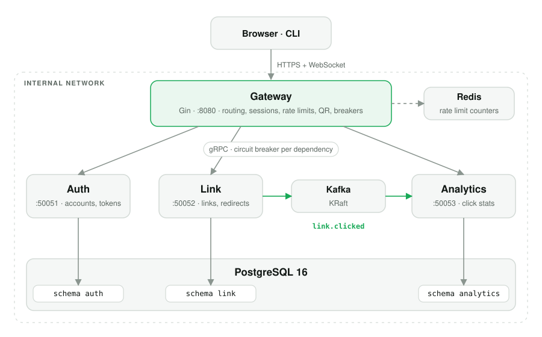

<div align="center">

<picture>
  <source media="(prefers-color-scheme: dark)" srcset="web/src/assets/brand/mark-dark.svg">
  
</picture>

# LinkForge

**Perpendek link. Lihat siapa yang mengkliknya.**

URL shortener open source yang dibangun sebagai empat microservice Go di balik satu HTTP gateway, dengan web app React: custom alias, masa berlaku, password, QR code, dan analitik klik, ditambah bagian-bagian yang dibutuhkan sistem sungguhan: event streaming, circuit breaker, rate limiting, keamanan sesi, dan observability.

[English](README.md) · **Bahasa Indonesia**

[](https://github.com/deaprima/linkforge/actions/workflows/ci.yml)
[](LICENSE)
[](services/go.mod)
[](web/package.json)
[](docker-compose.yml)
[](docker-compose.yml)
[](api/openapi.yml)

[Quick start](#quick-start) · [Fitur](#fitur) · [Arsitektur](#arsitektur) · [API](#api) · [Deployment](#deployment) · [Kontribusi](#kontribusi)

</div>

---

## Latar belakang

Dari luar, URL shortener terlihat sederhana: simpan URL panjang, berikan URL pendek, lalu redirect. LinkForge memakai
produk kecil ini untuk menunjukkan bagaimana sistem di sekelilingnya dibangun dengan benar:

- **Redirect tidak pernah menunggu.** Klik dikirim ke Kafka dan dihitung secara asinkron, sehingga service analitik yang
  lambat atau mati tidak pernah memperlambat redirect.
- **Kegagalan tetap terisolasi.** Setiap panggilan antar-service melewati circuit breaker. Saat satu dependency mati,
  bagian lain tetap berjalan dan browser diarahkan ke halaman yang ramah, bukan error mentah.
- **Penyalahgunaan sudah diantisipasi.** Login, pengecekan password, reset password, dan API publik dibatasi per IP,
  per user, atau per link.
- **Perilaku sistem dapat dipantau.** Log terstruktur dengan request ID, metrik Prometheus, dashboard Grafana, dan
  alert rule yang sudah diuji.

## Fitur

<table>
  <tr>
    <td width="33%" valign="top">
      <h3>Short link</h3>
      Custom alias, tanggal kedaluwarsa, dan password opsional. Tebakan password dibatasi per link dan per IP, dan link yang kedaluwarsa menjawab <code>410</code>.
    </td>
    <td width="33%" valign="top">
      <h3>QR code</h3>
      QR code untuk setiap link, di-render oleh Gateway dalam format PNG atau SVG dan dapat diunduh dari dashboard.
    </td>
    <td width="33%" valign="top">
      <h3>Analitik klik</h3>
      Klik per hari, negara, browser, dan perangkat, jumlah pengunjung unik, serta aliran klik real-time melalui WebSocket.
    </td>
  </tr>
  <tr>
    <td width="33%" valign="top">
      <h3>Event driven</h3>
      Service Link menerbitkan event <code>link.clicked</code> untuk setiap redirect, dan Analytics mengonsumsinya. Event yang gagal mencapai Kafka tetap dihitung, tidak hilang diam-diam.
    </td>
    <td width="33%" valign="top">
      <h3>Tahan gangguan</h3>
      Satu circuit breaker per dependency gRPC. Redirect tetap berjalan saat Analytics mati, dan browser melihat halaman <code>503</code>, bukan JSON mentah.
    </td>
    <td width="33%" valign="top">
      <h3>Rate limiting</h3>
      Batasan berbasis Redis per IP, per user, dan per link. Pengecekan password dan reset password bersifat fail-closed saat Redis tidak tersedia.
    </td>
  </tr>
  <tr>
    <td width="33%" valign="top">
      <h3>Keamanan sesi</h3>
      Access token JWT berumur pendek, refresh token yang dirotasi dengan deteksi pemakaian ulang di cookie HttpOnly, API key untuk skrip, login Google, serta token reset password sekali pakai yang di-hash.
    </td>
    <td width="33%" valign="top">
      <h3>Observability</h3>
      Log JSON dengan request ID, metrik Prometheus untuk HTTP, gRPC, breaker, dan Kafka, dashboard Grafana yang sudah di-provision, serta alert rule dengan unit test yang mengirim email lewat Alertmanager.
    </td>
    <td width="33%" valign="top">
      <h3>Contract first</h3>
      <code>api/openapi.yml</code> menjadi satu-satunya sumber untuk halaman referensi API di web app dan Swagger UI, dan CI memvalidasinya di setiap push.
    </td>
  </tr>
</table>

## Tech stack

| Layer | Teknologi |
|---|---|
| **Frontend** | React 19, TypeScript, Vite, Tailwind CSS v4, TanStack Query, React Router 7, Radix UI |
| **Backend** | Go, Gin (gateway), gRPC + Protocol Buffers, GORM, `segmentio/kafka-go`, `sony/gobreaker` |
| **Data** | PostgreSQL 16 (satu schema per service), Redis 7 (rate limit), Kafka 4.3 mode KRaft |
| **Kontrak API** | OpenAPI 3 (`api/openapi.yml`), ditampilkan di web app dan Swagger UI |
| **Observability** | `log/slog`, Prometheus, Grafana, Alertmanager |
| **Deployment** | Docker, Docker Compose, Caddy (HTTPS otomatis) |
| **Testing** | Go test dengan fake in-memory, integration test terhadap Postgres dan Kafka asli, Vitest + Testing Library, test rule `promtool` |

## Arsitektur

<picture>
  <source media="(prefers-color-scheme: dark)" srcset="assets/architecture-dark.svg">
  
</picture>

| Service | Tanggung jawab |
|---|---|
| **Gateway** | Satu-satunya pintu masuk publik. Routing, format response, rate limiting, circuit breaker, cookie sesi, render QR code, distribusi WebSocket. |
| **Auth** | Akun, access token JWT, refresh token yang dirotasi dengan deteksi pemakaian ulang, API key, Google OAuth, email reset password. |
| **Link** | Link, alias, masa berlaku, password, resolusi redirect. Menerbitkan event `link.clicked` ke Kafka untuk setiap redirect. |
| **Analytics** | Mengonsumsi `link.clicked`, mengagregasi klik per hari, negara, browser, dan perangkat, lalu menyajikan statistiknya. |

Antar-service berkomunikasi lewat gRPC. Hanya Gateway yang dapat diakses dari luar, dan setiap service memiliki schema
database sendiri.

```
linkforge/
├── api/openapi.yml           # kontrak API publik (OpenAPI 3)
├── assets/                   # gambar untuk README ini
├── services/                 # satu Go module, satu binary per service
│   ├── gateway/              # HTTP gateway (Gin)
│   ├── auth/ link/ analytics/
│   │   └── internal/         # config, delivery (gRPC), service, repository, entity
│   ├── shared/               # protobuf, circuit breaker, Kafka, database, logging, metrik
│   └── Dockerfile            # image multi-stage, satu per service
├── web/                      # React app: landing, dashboard, dokumentasi API, halaman auth
├── monitoring/               # Prometheus (rule + test), Grafana, Alertmanager
├── deploy/                   # image edge Caddy dan runbook production
├── docker-compose.yml        # infrastruktur development
├── docker-compose.prod.yml   # stack production di satu VPS
├── Makefile                  # perintah standar
└── .env.example              # konfigurasi lokal (salin ke .env)
```

## Quick start

### Prasyarat

- [Docker Desktop](https://www.docker.com/products/docker-desktop/) untuk PostgreSQL, Redis, dan Kafka
- [Go](https://go.dev/dl/) sesuai versi di [`services/go.mod`](services/go.mod) atau lebih baru
- [Node.js](https://nodejs.org/) 22 atau lebih baru (CI memakai versi di [`web/.nvmrc`](web/.nvmrc))
- `make` (opsional, tetapi menyederhanakan langkah di bawah)

### Menjalankan di lokal

```sh
git clone https://github.com/deaprima/linkforge.git
cd linkforge

cp .env.example .env          # lalu isi DB_PASSWORD dan JWT_SECRET, contoh: openssl rand -base64 48
make up                       # PostgreSQL, Redis, dan Kafka; menunggu sampai semuanya healthy
```

`.env.example` sudah disiapkan untuk development lokal (web app di port 5173). Dua catatan:

- `GOOGLE_CLIENT_ID` tidak boleh kosong, karena Auth menolak start tanpanya. Nilai placeholder sudah cukup kecuali Anda
  ingin mencoba login Google.
- Chrome dan Firefox menerima secure cookie di `http://localhost`. Jika memakai Safari, set `COOKIE_SECURE=false`.

Jalankan setiap service di terminal masing-masing **dari folder `services/`** (service membaca `../.env`), supaya log
tetap mudah dibaca:

```sh
cd services
go run ./auth/cmd/server        # gRPC :50051
go run ./link/cmd/server        # gRPC :50052
go run ./analytics/cmd/server   # gRPC :50053
go run ./gateway/cmd/server     # HTTP :8080, jalankan paling akhir
```

```sh
cd web
npm install
npm run dev                     # http://localhost:5173
```

Buka <http://localhost:5173/app/register> dan buat akun. Pastikan backend berjalan dengan `curl http://localhost:8080/healthz`.

**Email reset password.** Tanpa `SMTP_HOST`, Auth mencetak link reset ke log alih-alih mengirim email. Ini sudah cukup
untuk mencoba alurnya di lokal.

### Perintah standar

| Perintah | Fungsi |
|---|---|
| `make up` / `make down` | Menyalakan (dan menunggu) / mematikan infrastruktur development |
| `make lint` | `go vet` dan ESLint |
| `make test` | Unit test Go (integration test dilewati tanpa environment-nya) |
| `make test-integration TEST_DSN=...` | Test Go termasuk integration test Postgres dan Kafka |
| `make cover TEST_DSN=...` | Coverage lapisan inti per service; gagal jika di bawah 70% |
| `make proto` | Generate ulang kode Go dari file `.proto` (butuh `protoc`, `protoc-gen-go`, `protoc-gen-go-grpc`) |
| `docker compose up -d swagger-ui` | Swagger UI untuk spec yang sama di <http://localhost:8090> |

## Verifikasi sebelum membuat pull request

```sh
make lint
make test
cd web && npm test && npm run build
```

Test repository berjalan terhadap PostgreSQL sungguhan di schema sementara, sehingga database development dari `make up`
dapat dipakai:

```sh
make cover TEST_DSN="postgres://<DB_USER>:<DB_PASSWORD>@localhost:5432/linkforge?sslmode=disable"
```

`make cover` mengukur handler, service, dan repository (tidak termasuk `main`, kode hasil generate, dan entity). CI
menjalankan pemeriksaan yang sama terhadap container Postgres, ditambah validasi OpenAPI, build image Docker, dan test
alert rule.

## API

Semua yang dilakukan dashboard juga tersedia lewat HTTP. Referensi lengkapnya ada di
[halaman docs pada web app](http://localhost:5173/app/docs), yang dibangun dari [`api/openapi.yml`](api/openapi.yml). Contoh:

```sh
curl -X POST http://localhost:8080/api/v1/links \
  -H "X-API-Key: lf_sk_..." \
  -H "Content-Type: application/json" \
  -d '{"original_url": "https://example.com/a/very/long/url", "alias": "pitch"}'
```

Buat API key di menu **API keys** pada dashboard. Semua response memakai format yang sama
(`{ "success": true, "data": ... }` atau `{ "success": false, "error": { "code": ..., "message": ... } }`); gunakan
`error.code` untuk menentukan penanganan error.

API ini bersifat **contract first**: ubah `api/openapi.yml` sebelum kodenya, maka halaman docs ikut ter-update.

## Konfigurasi

Seluruh konfigurasi berupa environment variable yang dibaca dari `.env` di root repository (variabel yang sudah ada di
environment diprioritaskan). [`.env.example`](.env.example) memuat semua opsi beserta penjelasannya. Yang paling sering
diubah:

| Variabel | Dipakai oleh | Fungsi |
|---|---|---|
| `DB_*`, `REDIS_ADDR`, `KAFKA_BROKERS` | semua | Alamat infrastruktur |
| `JWT_SECRET`, `JWT_ACCESS_DURATION`, `JWT_REFRESH_DURATION` | Auth | Penandatanganan dan umur token (default 15 menit / 7 hari) |
| `FRONTEND_URL`, `BASE_URL`, `CORS_ALLOWED_ORIGINS` | Gateway, Auth | Lokasi web app, dan origin publik untuk short link |
| `COOKIE_SECURE` | Gateway | Tetap `true` di production; `false` hanya untuk http lokal di browser yang membutuhkannya |
| `TRUSTED_PROXIES` | Gateway | **Wajib di belakang reverse proxy**, jika tidak semua pengunjung berbagi satu kuota rate limit |
| `GOOGLE_CLIENT_ID`, `GOOGLE_CLIENT_SECRET` | Auth, Gateway | Login Google (kosongkan secret untuk menonaktifkannya) |
| `SMTP_HOST`, `SMTP_PORT`, `SMTP_USER`, `SMTP_PASS`, `SMTP_FROM` | Auth | Email reset password. Port 465 memakai TLS, selain itu STARTTLS |
| `VERIFY_LIMIT_*`, `FORGOT_LIMIT_*`, `RESET_LIMIT_*` | Gateway | Rate limit untuk pengecekan password dan reset password |
| `AUTH_LIMIT_*`, `PUBLIC_LIMIT_*`, `USER_LIMIT_*` | Gateway | Rate limit umum: login per IP, redirect per IP, API terautentikasi per user |
| `LOG_FORMAT`, `LOG_LEVEL` | semua | `json` (default) atau `text`; `debug`, `info`, `warn`, `error` |
| `DB_DEBUG` | Auth, Link, Analytics | `true` mencetak setiap SQL beserta nilainya. Hanya untuk development, jangan di production |
| `*_METRICS_ADDR` | semua | Listener internal `/metrics` dan `/healthz` (`:9100` sampai `:9103`). Jangan pernah dibuka ke internet |
| `GEOIP_DB_PATH` | Analytics | Database [GeoLite2-Country](https://dev.maxmind.com/geoip/geolite2-free-geolocation-data) opsional; tanpanya negara tampil sebagai `ZZ` |

## Monitoring

`docker compose up -d prometheus grafana` menjalankan Prometheus di `127.0.0.1:9090` dan Grafana di `127.0.0.1:3001`
(`admin` / `GRAFANA_ADMIN_PASSWORD`). Prometheus mengambil metrik keempat service di host melalui `host.docker.internal`,
dan Grafana sudah dilengkapi dashboard **LinkForge Overview**: request rate dan latency, rasio 5xx, latency dan error
gRPC per dependency, status circuit breaker, consumer lag Kafka, serta event klik yang hilang sebelum mencapai Kafka.

## Deployment

Stack production berjalan di satu VPS dengan Docker Compose. Caddy menangani HTTPS dan menyajikan web app serta API dari
satu origin; hanya port 80 dan 443 yang terbuka ke publik.

```sh
cp .env.prod.example .env.prod      # isi domain, secret, dan SMTP
docker compose --env-file .env.prod -f docker-compose.prod.yml up -d --build
```

Panduan lengkap, mulai dari persiapan server, update dan rollback, backup, alert, hingga troubleshooting, tersedia di
[deploy/README.md](deploy/README.md).

## Dokumentasi

| Dokumen | Isi |
|---|---|
| [deploy/README.md](deploy/README.md) | Setup production, update, backup, alert, troubleshooting |
| [api/openapi.yml](api/openapi.yml) | Kontrak API (OpenAPI 3) |
| [CONTRIBUTING.md](CONTRIBUTING.md) | Alur kerja, format commit message, dan strategi branch |
| [SECURITY.md](SECURITY.md) | Prosedur pelaporan celah keamanan |

## Status

LinkForge adalah proyek portofolio. Produk, web app, rate limiting, observability, dan stack production sudah selesai.
Langkah berikutnya adalah deployment publik.

## Kontribusi

Issue dan pull request sangat diterima. Baca [CONTRIBUTING.md](CONTRIBUTING.md) terlebih dahulu; di dalamnya dijelaskan
alur kerja, format commit message, dan alur branch. Dengan berpartisipasi, Anda setuju untuk mematuhi
[Code of Conduct](CODE_OF_CONDUCT.md).

Menemukan celah keamanan? Mohon jangan membuka issue publik; ikuti petunjuk pada [SECURITY.md](SECURITY.md).

## Lisensi

Dirilis di bawah lisensi [MIT](LICENSE). © 2026 Dea Prima
