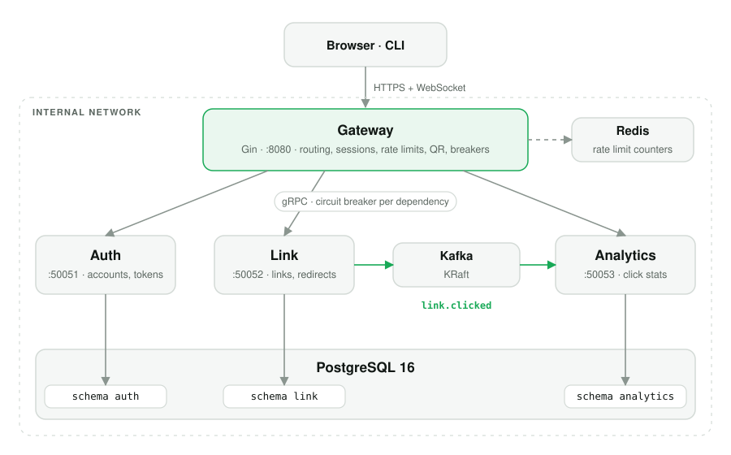

<div align="center">

<picture>
  <source media="(prefers-color-scheme: dark)" srcset="web/src/assets/brand/mark-dark.svg">
  
</picture>

# LinkForge

**Shorten a link. See who clicks it.**

An open source URL shortener built as four Go microservices behind one HTTP gateway, with a React web app: custom aliases, expiry, passwords, QR codes and click analytics, plus the parts around them that real systems need: event streaming, circuit breakers, rate limiting, session security and observability.

**English** · [Bahasa Indonesia](README.id.md)

[](https://github.com/deaprima/linkforge/actions/workflows/ci.yml)
[](LICENSE)
[](services/go.mod)
[](web/package.json)
[](docker-compose.yml)
[](docker-compose.yml)
[](api/openapi.yml)

[Quick start](#quick-start) · [Features](#features) · [Architecture](#architecture) · [API](#api) · [Deployment](#deployment) · [Contributing](#contributing)

</div>

---

## Why LinkForge

A URL shortener is simple on the surface: store a long URL, hand out a short one, redirect. LinkForge uses that small
product to show how the surrounding system is built properly:

- **The redirect never waits.** Clicks are published to Kafka and counted asynchronously, so a slow or broken analytics
  service never slows a redirect down.
- **Failures stay contained.** Every call between services goes through a circuit breaker. When a dependency is down,
  the rest keeps working and browsers land on a friendly page instead of an error.
- **Abuse is expected.** Sign-in, password checks, password reset and the public API are rate limited per IP, per user
  or per link.
- **You can see what it is doing.** Structured logs with request IDs, Prometheus metrics, a Grafana dashboard and tested
  alert rules.

## Features

<table>
  <tr>
    <td width="33%" valign="top">
      <h3>Short links</h3>
      Custom aliases, expiry dates and optional passwords. Password guesses are limited per link and per IP, and an expired link answers <code>410</code>.
    </td>
    <td width="33%" valign="top">
      <h3>QR codes</h3>
      A QR code for any link, rendered by the Gateway as PNG or SVG and ready to download from the dashboard.
    </td>
    <td width="33%" valign="top">
      <h3>Click analytics</h3>
      Clicks by day, country, browser and device, unique visitors, and a live click stream over WebSocket.
    </td>
  </tr>
  <tr>
    <td width="33%" valign="top">
      <h3>Event driven</h3>
      Link publishes a <code>link.clicked</code> event for every redirect and Analytics consumes it. Events that cannot reach Kafka are counted, not silently dropped.
    </td>
    <td width="33%" valign="top">
      <h3>Resilient by design</h3>
      A circuit breaker per gRPC dependency. Redirects keep working while Analytics is down, and browsers see a <code>503</code> page instead of raw JSON.
    </td>
    <td width="33%" valign="top">
      <h3>Rate limiting</h3>
      Redis backed limits per IP, per user and per link. Password checks and password reset fail closed when Redis is unavailable.
    </td>
  </tr>
  <tr>
    <td width="33%" valign="top">
      <h3>Session security</h3>
      Short lived JWT access tokens, rotating refresh tokens with reuse detection in an HttpOnly cookie, API keys for scripts, Google sign-in, and single-use hashed password reset tokens.
    </td>
    <td width="33%" valign="top">
      <h3>Observability</h3>
      JSON logs with request IDs, Prometheus metrics for HTTP, gRPC, breakers and Kafka, a provisioned Grafana dashboard, and alert rules with unit tests that email through Alertmanager.
    </td>
    <td width="33%" valign="top">
      <h3>Contract first</h3>
      <code>api/openapi.yml</code> is the single source for the API reference page in the web app and for Swagger UI, and CI validates it on every push.
    </td>
  </tr>
</table>

## Tech stack

| Layer | Technology |
|---|---|
| **Frontend** | React 19, TypeScript, Vite, Tailwind CSS v4, TanStack Query, React Router 7, Radix UI |
| **Backend** | Go, Gin (gateway), gRPC + Protocol Buffers, GORM, `segmentio/kafka-go`, `sony/gobreaker` |
| **Data** | PostgreSQL 16 (one schema per service), Redis 7 (rate limits), Kafka 4.3 in KRaft mode |
| **API contract** | OpenAPI 3 (`api/openapi.yml`), rendered in the web app and in Swagger UI |
| **Observability** | `log/slog`, Prometheus, Grafana, Alertmanager |
| **Deployment** | Docker, Docker Compose, Caddy (automatic HTTPS) |
| **Testing** | Go tests with in-memory fakes, integration tests against real Postgres and Kafka, Vitest + Testing Library, `promtool` rule tests |

## Architecture

<picture>
  <source media="(prefers-color-scheme: dark)" srcset="assets/architecture-dark.svg">
  
</picture>

| Service | Responsibility |
|---|---|
| **Gateway** | The only public entry point. Routing, the response envelope, rate limiting, circuit breakers, session cookies, QR code rendering, WebSocket fan-out. |
| **Auth** | Accounts, JWT access tokens, rotating refresh tokens with reuse detection, API keys, Google OAuth, password reset email. |
| **Link** | Links, aliases, expiry, passwords, redirect resolution. Publishes a `link.clicked` event to Kafka for every redirect. |
| **Analytics** | Consumes `link.clicked`, aggregates clicks by day, country, browser and device, and serves the stats. |

Services talk gRPC internally. Only the Gateway is reachable from outside, and each service owns its own database schema.

```
linkforge/
├── api/openapi.yml           # public API contract (OpenAPI 3)
├── assets/                   # images for this README
├── services/                 # one Go module, one binary per service
│   ├── gateway/              # HTTP gateway (Gin)
│   ├── auth/ link/ analytics/
│   │   └── internal/         # config, delivery (gRPC), service, repository, entity
│   ├── shared/               # protobuf, circuit breaker, Kafka, database, logging, metrics
│   └── Dockerfile            # multi-stage image, one per service
├── web/                      # React app: landing, dashboard, API docs, auth pages
├── monitoring/               # Prometheus (rules + tests), Grafana, Alertmanager
├── deploy/                   # Caddy edge image and the production runbook
├── docker-compose.yml        # development infrastructure
├── docker-compose.prod.yml   # production stack on one VPS
├── Makefile                  # standard commands
└── .env.example              # local configuration (copy to .env)
```

## Quick start

### Prerequisites

- [Docker Desktop](https://www.docker.com/products/docker-desktop/) for PostgreSQL, Redis and Kafka
- [Go](https://go.dev/dl/), the version in [`services/go.mod`](services/go.mod) or newer
- [Node.js](https://nodejs.org/) 22 or newer (CI uses the version in [`web/.nvmrc`](web/.nvmrc))
- `make` (optional, but it shortens the steps below)

### Run it locally

```sh
git clone https://github.com/deaprima/linkforge.git
cd linkforge

cp .env.example .env          # then set DB_PASSWORD and JWT_SECRET, e.g. openssl rand -base64 48
make up                       # PostgreSQL, Redis and Kafka; waits until all are healthy
```

`.env.example` is already set up for local development (the web app on port 5173). Two notes:

- `GOOGLE_CLIENT_ID` must not be empty or Auth refuses to start. The placeholder is fine unless you want Google sign-in.
- Chrome and Firefox accept secure cookies on `http://localhost`. On Safari, set `COOKIE_SECURE=false`.

Run each service in its own terminal **from `services/`** (they read `../.env`), so the logs stay readable:

```sh
cd services
go run ./auth/cmd/server        # gRPC :50051
go run ./link/cmd/server        # gRPC :50052
go run ./analytics/cmd/server   # gRPC :50053
go run ./gateway/cmd/server     # HTTP :8080, start this last
```

```sh
cd web
npm install
npm run dev                     # http://localhost:5173
```

Open <http://localhost:5173/app/register> and create an account. Check the backend with `curl http://localhost:8080/healthz`.

**Password reset emails.** Without `SMTP_HOST`, Auth prints the reset link to its log instead of sending mail, which is
enough to try the flow locally.

### Standard commands

| Command | What it does |
|---|---|
| `make up` / `make down` | Start (and wait for) / stop the development infrastructure |
| `make lint` | `go vet` and ESLint |
| `make test` | Go unit tests (integration tests are skipped without their environment) |
| `make test-integration TEST_DSN=...` | Go tests including the Postgres and Kafka integration tests |
| `make cover TEST_DSN=...` | Coverage of the core layers per service; fails below 70% |
| `make proto` | Regenerate Go code from `.proto` files (needs `protoc`, `protoc-gen-go`, `protoc-gen-go-grpc`) |
| `docker compose up -d swagger-ui` | Swagger UI for the same spec on <http://localhost:8090> |

## Before you open a pull request

```sh
make lint
make test
cd web && npm test && npm run build
```

Repository tests run against a real PostgreSQL in a throwaway schema, so the development database from `make up` works:

```sh
make cover TEST_DSN="postgres://<DB_USER>:<DB_PASSWORD>@localhost:5432/linkforge?sslmode=disable"
```

`make cover` measures handlers, services and repositories (not `main`, generated code or entities). CI runs the same
check against a Postgres service container, plus the OpenAPI validation, Docker image builds and the alert rule tests.

## API

Everything the dashboard does is available over HTTP. The full reference is the
[docs page in the web app](http://localhost:5173/app/docs), built from [`api/openapi.yml`](api/openapi.yml). A taste:

```sh
curl -X POST http://localhost:8080/api/v1/links \
  -H "X-API-Key: lf_sk_..." \
  -H "Content-Type: application/json" \
  -d '{"original_url": "https://example.com/a/very/long/url", "alias": "pitch"}'
```

Create an API key under **API keys** in the dashboard. Responses share one envelope (`{ "success": true, "data": ... }`
or `{ "success": false, "error": { "code": ..., "message": ... } }`); branch on `error.code`.

The API is **contract first**: change `api/openapi.yml` before the code, and the docs page updates itself.

## Configuration

All configuration is environment variables, read from `.env` at the repository root (variables already set in the
environment win). [`.env.example`](.env.example) lists every option with comments. The ones you are most likely to touch:

| Variable | Used by | Purpose |
|---|---|---|
| `DB_*`, `REDIS_ADDR`, `KAFKA_BROKERS` | all | Infrastructure addresses |
| `JWT_SECRET`, `JWT_ACCESS_DURATION`, `JWT_REFRESH_DURATION` | Auth | Token signing and lifetime (15 minutes / 7 days by default) |
| `FRONTEND_URL`, `BASE_URL`, `CORS_ALLOWED_ORIGINS` | Gateway, Auth | Where the web app lives, and the public origin of short links |
| `COOKIE_SECURE` | Gateway | Keep `true` in production; `false` only for local http on browsers that need it |
| `TRUSTED_PROXIES` | Gateway | **Required behind a reverse proxy**, otherwise every visitor shares one rate limit |
| `GOOGLE_CLIENT_ID`, `GOOGLE_CLIENT_SECRET` | Auth, Gateway | Google sign-in (leave the secret empty to turn it off) |
| `SMTP_HOST`, `SMTP_PORT`, `SMTP_USER`, `SMTP_PASS`, `SMTP_FROM` | Auth | Password reset email. Port 465 uses TLS, anything else uses STARTTLS |
| `VERIFY_LIMIT_*`, `FORGOT_LIMIT_*`, `RESET_LIMIT_*` | Gateway | Rate limits for password checks and password reset |
| `AUTH_LIMIT_*`, `PUBLIC_LIMIT_*`, `USER_LIMIT_*` | Gateway | General rate limits: sign-in per IP, redirects per IP, authenticated API per user |
| `LOG_FORMAT`, `LOG_LEVEL` | all | `json` (default) or `text`; `debug`, `info`, `warn`, `error` |
| `DB_DEBUG` | Auth, Link, Analytics | `true` prints every SQL statement with its values. Development only; never in production |
| `*_METRICS_ADDR` | all | Internal `/metrics` and `/healthz` listener (`:9100` to `:9103`). Never expose it to the internet |
| `GEOIP_DB_PATH` | Analytics | Optional [GeoLite2-Country](https://dev.maxmind.com/geoip/geolite2-free-geolocation-data) database; without it countries show as `ZZ` |

## Monitoring

`docker compose up -d prometheus grafana` starts Prometheus on `127.0.0.1:9090` and Grafana on `127.0.0.1:3001`
(`admin` / `GRAFANA_ADMIN_PASSWORD`). Prometheus scrapes the four services on the host through
`host.docker.internal`, and Grafana comes with a provisioned **LinkForge Overview** dashboard: request rate and latency,
5xx ratio, gRPC latency and errors per dependency, circuit breaker state, Kafka consumer lag, and click events lost
before they reach Kafka.

## Deployment

The production stack runs on one VPS with Docker Compose. Caddy terminates HTTPS and serves the web app and the API from
one origin; only ports 80 and 443 are public.

```sh
cp .env.prod.example .env.prod      # fill in the domain, secrets and SMTP
docker compose --env-file .env.prod -f docker-compose.prod.yml up -d --build
```

The full guide, covering server preparation, updates and rollback, backups, alerts and troubleshooting, is in
[deploy/README.md](deploy/README.md).

## Documentation

| Document | Contents |
|---|---|
| [deploy/README.md](deploy/README.md) | Production setup, updates, backups, alerts, troubleshooting |
| [api/openapi.yml](api/openapi.yml) | API contract (OpenAPI 3) |
| [CONTRIBUTING.md](CONTRIBUTING.md) | Workflow, commit messages and branch strategy |
| [SECURITY.md](SECURITY.md) | How to report a vulnerability |

## Status

LinkForge is a portfolio project. The product, the web app, rate limiting, observability and the production stack are
done. Next up is the public deployment.

## Contributing

Issues and pull requests are welcome. Please read [CONTRIBUTING.md](CONTRIBUTING.md) first; it covers the workflow,
commit messages and the branch flow. Everyone taking part is expected to follow the
[Code of Conduct](CODE_OF_CONDUCT.md).

Found a security problem? Please do not open a public issue; follow [SECURITY.md](SECURITY.md).

## License

Released under the [MIT](LICENSE) license. © 2026 Dea Prima
